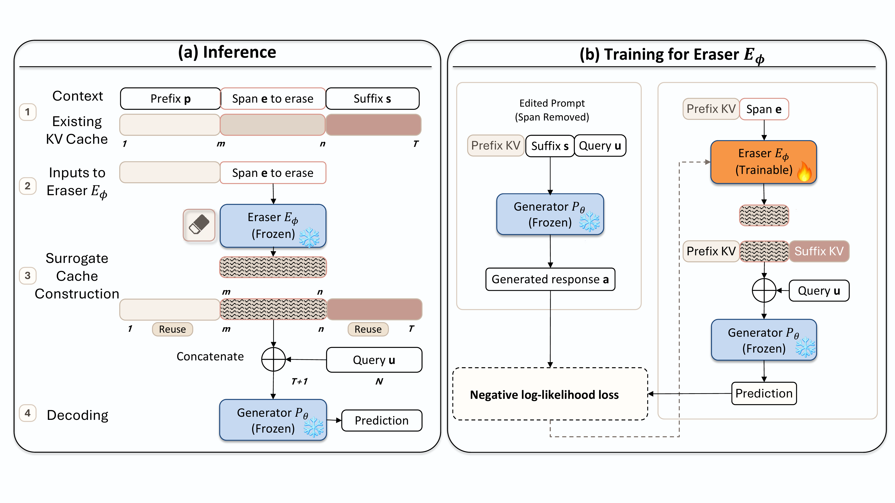

# KVEraser

[](https://arxiv.org/abs/2606.17034)



## Table of Contents

- [Setup](#setup)
- [Training](#training)
- [KVEraser Evaluation](#kveraser-evaluation)

## Setup

```bash
conda create -n kveraser python=3.11 -y
conda activate kveraser
pip install -r requirements.txt
```

Authenticate for W&B logging:

```bash
wandb login
```

## Training

```bash
CUDA_VISIBLE_DEVICES=0,1 python train.py \
  --output_dir checkpoints/kveraser_niah_joint \
  --wandb_project kveraser-niah
```

## KVEraser Evaluation

```bash
CUDA_VISIBLE_DEVICES=0 python evaluate_kveraser.py \
  --model Qwen/Qwen3-8B \
  --checkpoint checkpoints/kveraser_niah_joint \
  --placement single_gpu
```

## Exact Recompute Evaluation

Exact recomputation has no eraser checkpoint dependency:

```bash
CUDA_VISIBLE_DEVICES=0 python evaluate_recompute.py \
  --model Qwen/Qwen3-8B \
  --placement single_gpu
```

It removes the designated span from the cached prompt, reuses the valid prefix cache, recomputes the complete edited suffix, then uses the same delayed-query processing and greedy decoding behavior as KVEraser.

## Timing Boundary

Both evaluation scripts prefill the original context before timing starts. Timed latency begins after the original-context KV cache exists and includes:

- KVEraser cache editing or exact suffix recomputation
- delayed-query processing
- complete greedy decoding

CUDA is synchronized around timed regions. One untimed warmup sample is run per context. The scripts print GPU name/count, Torch/CUDA versions, dtype, attention backend, and resolved generator device map.

## Citation

```bibtex
@article{li2026kveraser,
  title={KVEraser: Learning to Steer KV Cache for Efficient Localized Context Erasing},
  author={Li, Mufei and Liu, Shikun and Fu, Dongqi and Wang, Haoyu and Xia, Yinglong and Li, Hong and Yan, Hong and Li, Pan},
  journal={arXiv preprint arXiv:2606.17034},
  year={2026}
}
```
